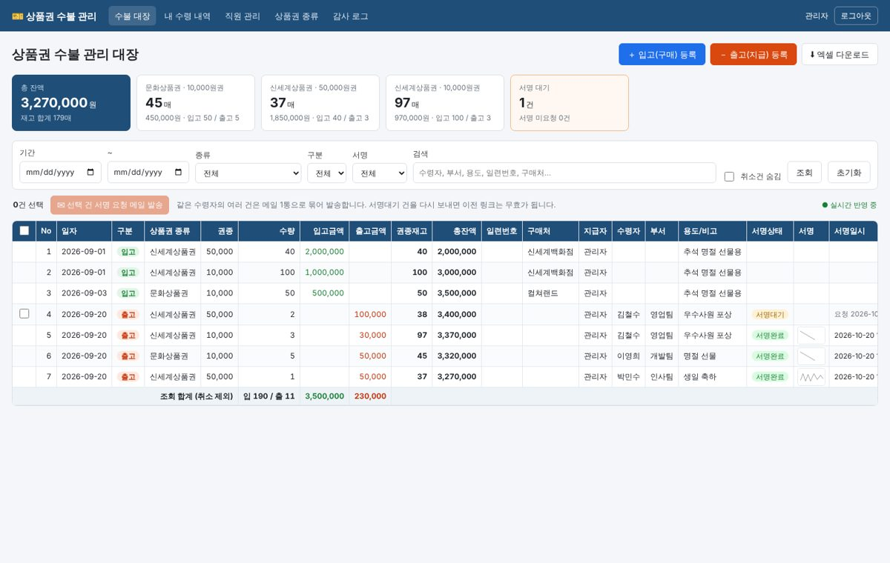
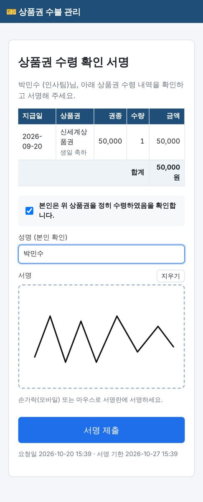

# 상품권 수불 관리 및 전자서명 시스템

사내 NAS(Docker)에 올려 전직원이 웹 브라우저로 사용하는 **상품권 수불(입·출고) 대장 + 아웃룩 메일 전자서명** 시스템입니다.

| 수불 관리 대장 (관리자 PC) | 수령 확인 서명 (직원 모바일) |
|---|---|
|  |  |

## 주요 기능

- **접속은 관리자만**: 관리자는 회사 Microsoft 365(Outlook) 계정으로 로그인합니다(Microsoft Entra ID, 실적 대시보드와 같은 방식). 수령자 명단에서 '관리자'인 계정만 들어올 수 있습니다. Entra 앱 등록 전에는 임시로 메일 인증코드 로그인을 쓸 수 있습니다.
- **직원은 로그인하지 않음**: 상품권을 받은 직원은 메일로 온 링크에서 서명만 합니다.
- **엑셀형 수불 대장**: 일자, 구분, 상품권 종류, 권종, 수량, 입고/출고 금액, **권종별 재고**, **총 잔액**, 일련번호, 구매처, 지급자, 수령자, 용도, 서명 상태, **서명 이미지**, 서명 일시를 한 시트에 누적 기록합니다.
  - 입고(구매)를 등록하면 재고와 잔액이 자동으로 늘고(+), 출고(지급)를 등록하면 자동으로 줄어듭니다(−).
  - 재고보다 많이 출고할 수 없습니다. 과거 일자로 출고해서 그 이후 재고가 음수가 되는 경우도 막습니다.
  - 내역은 **삭제하지 않고** '취소(정정)'로만 처리하여 영구 보존합니다. 취소 사유와 처리자가 남습니다.
  - 기간, 종류, 구분, 서명 상태, 검색어로 필터링할 수 있고, **엑셀(.xlsx) 다운로드** 시 서명 이미지가 셀에 함께 들어갑니다.
- **아웃룩 메일 전자서명**
  1. 관리자가 출고를 등록하면서 '서명 요청'을 선택하거나, 대장에서 여러 건을 체크해 '서명 요청 메일 발송'을 누릅니다. 같은 수령자의 여러 건은 메일 1통으로 묶어 보냅니다.
  2. 직원이 아웃룩에서 링크를 열고(로그인 없음) PC나 모바일에서 ① 수령 확인에 동의하고 ② 본인 성명을 입력한 뒤 ③ 손가락이나 마우스로 서명합니다.
  3. 서명 이미지(PNG), 서명 일시, IP, 기기 정보, 위변조 확인용 SHA-256 해시가 대장의 해당 행에 저장됩니다. 대장 화면은 10초마다 변경을 확인해 **자동으로 새로고침**합니다.
  - 링크는 1회용이며 기본 7일 후 만료됩니다. 재발송하면 이전 링크는 무효가 됩니다.
- **관리 기능**: 수령자 명단(개별 등록 또는 엑셀 일괄 등록·받기), 상품권 종류·권종 관리, 감사 로그(누가 언제 무엇을 했는지)
- **운영**: 매일 자동 DB 백업, 위험한 설정이면 시작 거부, 화면 아래와 `/healthz` 응답 머리글(`X-App-Version`)에 버전 표시

## 기술 스택

| 구분 | 선택 | 이유 |
|---|---|---|
| 백엔드 | Python 3.12 + Flask 3, Gunicorn | 가볍고 코드가 단순해 사내 유지보수가 쉬움 |
| DB | SQLite (WAL 모드) | 별도 DB 서버 불필요, 파일 1개라 NAS 백업이 쉬움, 수백 명 규모에 충분 |
| 화면 | 서버 렌더링(Jinja2) + 순수 JS/CSS | 외부 CDN 의존 없음 → 인터넷이 막힌 사내망에서도 동작 |
| 서명 | HTML5 Canvas (Pointer Events) | PC 마우스, 모바일 터치, 펜 모두 지원 |
| 관리자 로그인 | Microsoft Entra ID (OIDC + PKCE, PyJWT) | 회사 계정 그대로 사용, 사내 다른 앱과 같은 방식 |
| 메일 | Microsoft Graph `sendMail` (또는 SMTP) | Microsoft 365 는 SMTP AUTH 를 막는 경우가 많아 Graph 권장 |
| 엑셀 | openpyxl | 서명 이미지가 포함된 .xlsx 생성 |
| 배포 | Docker / docker compose (host 네트워크 + DSM 역방향 프록시) | 사내 Synology NAS 에서 실적 대시보드와 같은 방식 |

## 설치 (NAS)

```bash
cd /volume1/docker/voucher-ledger
sudo mkdir -p data && sudo chown -R <UID>:<GID> data   # 앱 실행 계정
cp .env.example .env && vi .env                        # PUBLIC_URL, SESSION_SECRET, OIDC_*, MAIL_* …
sudo docker compose up -d --build
# DSM 역방향 프록시: https 7031 → http://127.0.0.1:7030
```

Entra 앱 등록(리디렉션 URI, 메일 발송 권한), 역방향 프록시, 방화벽, 백업 방법은
**[docs/NAS_DEPLOY.md](docs/NAS_DEPLOY.md)** 에 단계별로 정리했습니다.

### 처음 사용하는 순서

1. `.env` 의 `ADMIN_EMAILS` 에 적은 관리자(본인)가 Microsoft 365 계정으로 로그인합니다.
2. **수령자 명단** 메뉴에서 "현재 명단 엑셀로 받기"로 양식을 받아 상품권을 받을 직원을 채운 뒤 올립니다. (`이메일, 성명, 부서, 사번`)
3. **상품권 종류** 메뉴에서 권종을 등록합니다. (예: 신세계상품권 50,000 / 10,000)
4. **수불 대장**에서 입고를 등록한 다음 출고(지급)를 등록하고 서명 요청을 보냅니다.

## 로컬 개발 / 테스트

```bash
python3 -m venv .venv && . .venv/bin/activate
pip install -r requirements-dev.txt
DEV_MODE=1 AUTH_MODE=email DEV_SHOW_CODES=1 PORT=8000 \
  ADMIN_EMAILS=admin@bdo.kr:관리자 python wsgi.py                     # http://localhost:8000 (인증코드가 화면에 표시됨)
pytest                                                                    # 자동 테스트
```

## 폴더 구조

```
app/
  __init__.py        앱 생성, CLI(create-admin, backup)
  config.py          환경변수 설정, 운영 설정 검사
  oidc.py            Microsoft 365(Entra ID) 로그인 (OIDC + PKCE, ID 토큰 검증)
  backup.py          매일 자동 DB 백업
  schema.sql         DB 스키마 (자동 생성)
  db.py              SQLite 연결, 트랜잭션
  services.py        입출고·재고·잔액 계산, 취소, 서명 요청/완료, 엑셀 내보내기
  auth.py            관리자 로그인 (Microsoft 365 / 임시 메일 인증코드)
  ledger.py          수불 대장 화면, 입출고, 서명 요청, 엑셀 다운로드
  sign.py            전자서명 페이지
  admin.py           직원, 상품권 종류, 감사 로그
  mailer.py          메일 발송 (Microsoft Graph / SMTP)
  templates/         화면 및 메일 템플릿
  static/            CSS, JS (서명 패드, 대장 화면)
docs/
  DESIGN.md          설계 문서 (DB 구조, 처리 흐름, 보안)
  NAS_DEPLOY.md      NAS 배포 가이드
tests/               자동 테스트 (pytest)
Dockerfile, docker-compose.yml, .env.example, VERSION, CHANGELOG.md
```

## 데이터 저장 위치

모든 데이터는 `./data` 폴더(컨테이너 안에서는 `/data`)에 저장됩니다. **이 폴더만 백업하면 됩니다.**

```
data/
  voucher.db           DB (대장, 직원, 서명 요청, 감사 로그)
  signatures/*.png     서명 이미지
  backups/             자동 백업(매일) 과 'flask backup' 명령으로 만든 사본
```
